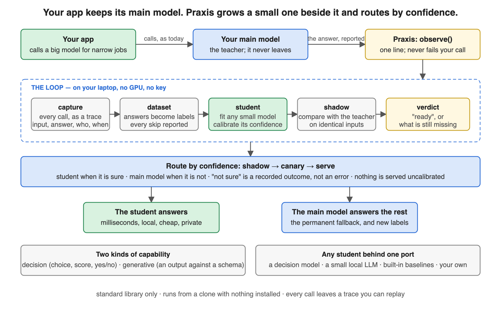
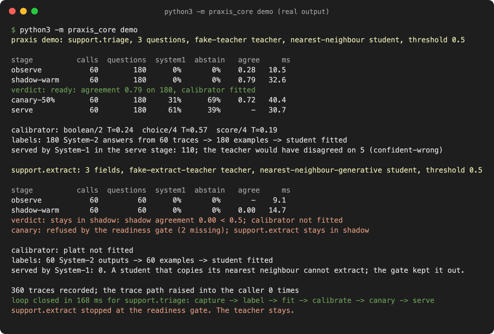
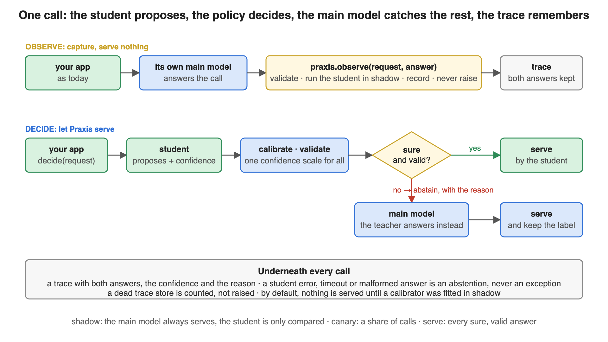

# Praxis

[](https://github.com/arupmmi07/praxis/actions/workflows/tests.yml)
[](https://www.python.org/downloads/)
[](LICENSE)

*Capture what your big model does. Grow a small one to take over, safely.*

**Praxis is a small Python library for apps that call a big model for narrow jobs:**
which team gets this ticket, how urgent is it, pull the order number out of it. Praxis
watches those calls, turns the answers into training data, fits a small model, measures it
against the big one, says when it is ready, and serves it for the calls it is sure about.
The big model answers everything else.



## The problem it solves

Every app built on a big model ends up with the same narrow, repetitive calls:

1. each call costs money and takes a second or more,
2. the app depends on someone else's API staying up,
3. the knowledge of how this app's jobs are done is thrown away after each call,
4. nobody dares to swap in a small model: a confident wrong answer is worse than a slow one.

Praxis keeps the answers and grows a small model that earns its share of traffic one
measured step at a time. The big model stays as the fallback.

## Three words you need

- **Capability** — one narrow job, declared once: typed questions (a choice, a score, a
  yes/no) or an output against a schema (three fields out of a ticket).
- **Teacher** — your big model, the one that answers today. Praxis never replaces it.
- **Student** — the small model Praxis grows for one capability. It serves only when it
  is calibrated and sure.

## See it work in sixty seconds

No install, no keys. Two example capabilities over synthetic tickets, a keyword rule as
the big model.

```bash
git clone https://github.com/arupmmi07/praxis.git
cd praxis
python3 -m praxis_core demo
```



## Use it in your own project, five steps

**1. Install** (Python 3.11 or newer):

```bash
pip install -e .            # from a clone; the package is not on PyPI yet
```

**2. Declare the capability**, as typed questions or as an output schema:

```python
from praxis_core import Capability, Question

triage = Capability("support.triage", questions={
    "department": Question.choice("Which team should handle this ticket?", {"billing": "...", "technical": "..."}),
    "urgency":    Question.score("How urgent is this ticket?", ["low", "medium", "high", "critical"]),
    "churn_risk": Question.boolean("The customer is at risk of cancelling."),
})
```

**3. Capture.** Your app keeps calling its own model. One line after that call records
the answer and never fails your request:

```python
from praxis_core import DecisionRouter, ModelInfo
from praxis_core.trace import JsonlTraceSink, QueuedTraceSink

sink = QueuedTraceSink(JsonlTraceSink("traces.jsonl"))
router = DecisionRouter(triage, teacher=my_teacher, sink=sink)             # shadow stage by default

answers = my_big_model(ticket)                                            # unchanged
router.observe_state(ticket, answers, ModelInfo("my-provider", "big-model"), latency_ms=820)
```

**4. Fit a student and let it shadow.** Build the dataset, fit a student, give it to the
router with a calibrator, and keep observing:

```python
from praxis_core import RoutingPolicy
from praxis_core.baseline import NearestNeighbourDecisionModel
from praxis_core.calibrate import TemperatureCalibrator
from praxis_core.dataset import examples_from_traces

examples, report = examples_from_traces(sink.read("support.triage"), triage)   # every skip is reported
student = NearestNeighbourDecisionModel(); student.fit(examples)
router = DecisionRouter(triage, teacher=my_teacher, system1=student, calibrator=TemperatureCalibrator(),
                        sink=sink, policy=RoutingPolicy(threshold=0.6))   # still shadow; calibration required
```

**5. Serve by confidence.** Let Praxis make the call; the student answers what it is
sure about, the main model the rest:

```python
router.calibrator.fit(list(sink.read("support.triage")))
print(router.readiness())                              # "ready: ..." or "stays in shadow: <what is missing>"
router.set_stage("canary", canary_share=0.2)           # raises NotReady, naming what is missing, until ready
result = router.decide_state(ticket)["urgency"]        # .answer, .confidence, .answered_by ("system1" when sure)
```

A capability with an `output_schema` goes through `GenerativeRouter` the same way. A real
local model can play student or teacher through the plug-in in `praxis_core.providers`.

## What happens on every call



The student only *proposes*. Praxis puts its confidence on one scale, checks the answer
is valid, and decides. A sure, valid answer is served; anything else is an **abstention**,
recorded with its reason, and the main model answers. A student that errors, stalls or
returns garbage can never fail your call. Details: [docs/architecture.md](docs/architecture.md).

## What you get out of the box

- **Two capability kinds**, typed questions and schema outputs, one loop.
- **Any student behind one interface**: a decision model, a small local LLM, a baseline, yours.
- **Calibration built in**; by default nothing is served until a calibrator is fitted.
- **Shadow, canary, serve**, with the main model as the permanent fallback.
- **A replayable trace of every call**, JSONL or SQLite, behind a background queue.
- **A readiness verdict** after shadow; the stage cannot be raised until it is ready.
- **A plug-in for any local model server**, as student or teacher.
- **Every guarantee is a test**, named in [the architecture doc](docs/architecture.md#guarantees-and-the-test-that-proves-each).

## What it is not

Not a proxy in front of your app: it is imported inside it, where the types still exist.
Not a model, not a hosted service, and not a way to remove the big model.

## Status

Version 0.3.1, the first milestone of the [v1.0 plan](docs/release-plan-v1.0.md). 163
tests on Python 3.11 to 3.14, lint and type checks in CI, standard library only. Next on
the [roadmap](ROADMAP.md): the dataset builder and the paired scorecard (0.4.0).

## Read more

| | |
|---|---|
| [How it works](docs/architecture.md) | the contract, one call, the trace, the guarantees |
| [Design decisions](docs/decisions.md) | twelve dated decisions |
| [v1.0 release plan](docs/release-plan-v1.0.md) | the MVP, what waits, the release bar |
| [Roadmap](ROADMAP.md) | every planned feature, status, owner |
| [Changelog](CHANGELOG.md) | what changed, per version |
| [Contributing](CONTRIBUTING.md) | `make check`; picking a roadmap row |

## Licence

Apache 2.0.
