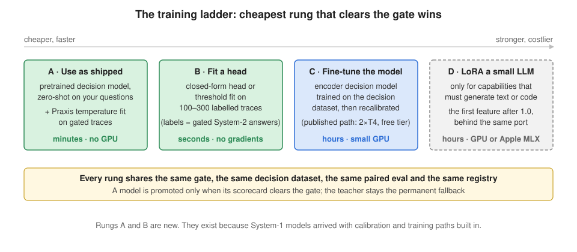

# Architecture

Praxis is a library inside the application, not a proxy in front of a provider. A proxy
sees bytes; the seam sees a declared shape. That decision from the original design is
unchanged. What changed is the student: for any capability whose answer is a choice, a
score or a yes/no, the student is a **System-1 decision model** behind a
provider-neutral port, and the LLM becomes **System-2**, the permanent fallback and the
source of labels.

```
  1 contract     what is being asked, in types: a state and named questions
  2 router       who answers each question, and why
  3 calibrator   one confidence scale for every provider
  4 trace        what happened, replayable, with both answers when there are two
  5 dataset      which System-2 answers become labels, and which are refused
  6 student      a decision model behind one port: the baseline today, real ones next
  7 evaluate     is the student worth promoting? (Phase 3)
```

## 1 · The contract

`praxis/core/contracts.py`. A `Capability` is a name (`<domain>.<operation>`), a kind
(`decision` or `generative`) and, for a decision, its `Question`s:

| Type | Declares | Answer | Distribution keys |
|---|---|---|---|
| `choice` | `options: {key: description}` | the key | the option keys |
| `score` | `levels: [low ... high]` | the level index | `"0"`, `"1"`, ... |
| `boolean` | instructions only | `True` / `False` | `"true"`, `"false"` |
| `rank` | `options` | keys, best first | the option keys (derived from `choice`) |

`noul`, the vendors' name for the yes/no type, is accepted on input and never written.
`rank` is derived: adapters see the `choice` form and the router sorts the calibrated
distribution, so no provider has to support it.

A `DecisionRequest` carries the state, the questions as presented (options can be
dynamic per call; names and types must match the declaration) and an opaque
`RequestContext` (host partition, caller, budget). A `DecisionResult`, one per question,
carries the answer, the calibrated distribution, `confidence` on the Praxis scale,
`native_confidence` as the provider reported it, `calibrated`, `abstain`, `answered_by`,
who answered, latency, cost and the trace id.

**Confidence** is `1 - H(p) / log(n)` on the calibrated distribution: one-hot is 1.0,
uniform is 0.0, and the formula is the same for a two-way boolean and a twenty-way
choice. Whatever the provider says about itself is kept beside it and never routed on.

## 2 · The router


`praxis/core/router.py`, one router per capability. Per call, in order:

1. Resolve the policy: threshold, stage (`shadow` | `canary` | `serve`), canary share,
   System-1 timeout (capped by the request's budget).
2. Call the System-1 adapter on a bounded thread, timed.
3. Pass each raw distribution through the calibrator; compute Praxis confidence.
4. Validate: keys match the question, probabilities are finite and sum to one, the answer
   is in the declared set.
5. In `serve`, or in `canary` when this call is in the share, every question that is
   valid and at or above the threshold is served by System-1.
6. Every other question is an **abstention**: recorded with its reason, sent to the
   teacher with the same state, served from the teacher's answer, and marked as a
   candidate label. The teacher is asked only the abstaining questions.
7. In `shadow` the teacher answers everything, and steps 2 to 4 still run, so the trace
   holds both answers side by side.
8. Record the trace. Nothing on that path can raise into the caller.

| Condition | Outcome |
|---|---|
| System-1 raises, times out, returns garbage, or is absent | abstain with the reason; the teacher serves |
| the calibrator returns something that is not a distribution | abstain with the reason |
| valid, at or above the threshold, stage allows | served by System-1 |
| valid, below the threshold | abstain: `below threshold` |
| canary and this call is outside the share | abstain: `canary` |
| the teacher raises or answers outside the declared set | the trace is recorded with `success = false`, then `TeacherError` |

The last row is the one place a call can fail. The teacher is the caller's own System-2,
there is nothing behind it, and hiding its failure would mean inventing an answer.

## 3 · The calibrator

`praxis/core/calibrate.py`. Every provider reports probabilities on its own terms. Praxis
fits one temperature per (question type, option count) on traces that carry both the raw
System-1 distribution and the System-2 label, minimising the negative log-likelihood of
the labels by golden-section search: no gradients, no dependency, milliseconds. `T > 1`
softens an over-confident model, `T < 1` sharpens an under-confident one. A group that
has not been fitted passes through unchanged and the result says `calibrated = False`,
so a threshold applied to it is applied to the provider's own scale, and the trace says
so. The calibrator's `version` is recorded on every trace it touched.

## 4 · The trace

`TraceEvent` (envelope version 2) has three layers. The **Praxis envelope** is stable
across hosts and holds no host type: who ran, which stage, who answered, latencies,
cost, success, lineage (`source`, `label_candidate`, `teacher_distillable`,
`dataset_version`), and per question the type, the definition hash, the question as
presented, the raw and calibrated distributions, the confidence, the native confidence,
the calibrator version, `abstain`, `answered_by`, and the System-1 and System-2 answers.
The **host partition** is the host's own isolation key, opaque. The **payload** is the
state and the late-bound `outcome` and `feedback`, which Praxis stores and never
interprets. Plain dataclasses, `to_dict` / `from_dict`, no serialisation library.

Sinks (`praxis/core/trace.py`): JSONL appends one object per line and the reader keeps
the latest per trace id; SQLite keeps envelope columns plus the JSON body and replaces
by trace id. Both read back by capability. A sink may raise; the router counts it.

## 5 · From traces to a dataset

`praxis/core/dataset.py`. A System-2 answer on a trace marked as a label candidate
becomes a `DecisionExample`: capability, question, type, state, the options or levels
as presented, the label, its source, the teacher's distribution when there was one, and
lineage. A trace whose question definition hash no longer matches the capability's
current one is **skipped and reported**, never silently dropped: a quietly edited option
list must not poison a dataset. Group-aware splitting, decontamination and the manifest
are Phase 4.

## 6 · The student

`praxis/core/ports.py` fixes the port: `decide(state, questions) -> {name: RawAnswer}`,
a distribution per question plus whatever confidence the provider reports. Anything with
that shape routes, and the fault-injection tests are the contract it is held to.

The baseline (`praxis/core/baseline.py`) is the original nearest-neighbour student
expressed as a distribution: the `k` most similar remembered examples vote with their
Jaccard similarity cubed, and the vote is mixed with a uniform prior in proportion to how
weak the best match was, so a query that resembles nothing is uniform (confidence 0,
never served) and a near-duplicate is peaked. Unfitted, it is uniform for everything.



Climb per capability, stop at the first rung whose scorecard clears the gate. Rung A
(a pretrained decision model plus a fitted temperature) is what the calibrator already
does; Rungs B and C arrive with the trainers; Rung D is the generative path below.

## 7 · The generative path

The original modules stay for capabilities that must generate text or code:
`praxis/seam.py` (a capability with an output schema and the dict-of-types validator,
now behind the `SchemaValidator` port), `praxis/gate.py` (four checks: right capability,
valid schema, within the latency bound, not a duplicate; rejections counted by reason),
`praxis/student.py` (`LoraStudent`, whose `fit` raises until a backend is wired in),
`praxis/router.py` and `praxis/evaluate.py` (confident-wrong reported separately from
deflection). The `GenerativeModel` port is declared; routing generative capabilities
through the same policy is a later milestone (see [ROADMAP.md](../ROADMAP.md)).

## What is deliberately not here

A web dashboard, a REST control plane, role-based access, cloud deployment, Postgres as
the default store, and any provider-specific extension surfaced through the portable
API. The CLI and JSON artifacts are the interface.
