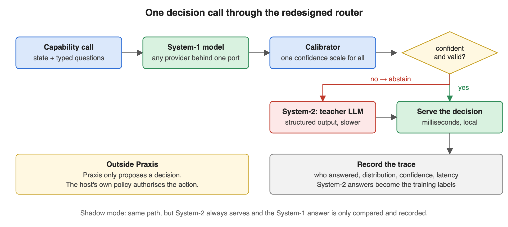
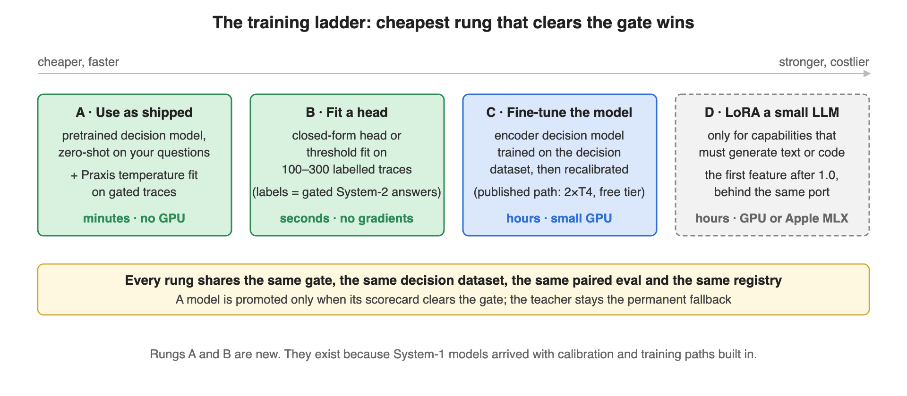

# Architecture

Praxis is a library inside the application, not a proxy in front of a provider. A proxy
sees bytes; the seam sees a declared shape. That decision from the original design is
unchanged. What changed is the student: for any capability whose answer is a choice, a
score or a yes/no, the student is a **System-1 decision model** behind a
provider-neutral port, and the LLM becomes **System-2**, the permanent fallback and the
source of labels.

```
  0 capture      the app's own model answers; Praxis records it (observe mode)
  1 contract     what is being asked, in types: named questions, or an output schema
  2 router       who answers, and why: decision and generative kinds, same steps
  3 calibrator   one confidence scale for every provider: a temperature, or a Platt map
  4 trace        what happened, replayable, with both answers when there are two
  5 dataset      which System-2 answers become labels, and which are refused
  6 student      any model behind one of two ports: baselines today, real ones next
  7 evaluate     is the student worth promoting? (0.4.0 and 0.5.0)
```

## 0 · Capture first: observe mode

The original design's wedge. The app keeps calling its own model and hands Praxis the
answer: `router.observe(request, answers, info, latency_ms, cost_usd)`. Praxis validates
the answer against the declared set (or schema), runs the configured student in shadow,
records the trace with the app's answer as System-2 and the student's beside it, and
returns the trace. It never raises: a bad request or an invalid answer is a recorded
failure that becomes no label; anything unexpected is counted on the router's stats.
`TraceEvent.to_request()` rebuilds the request a trace recorded, which is the
replay-equivalence property. In front of any sink, `QueuedTraceSink` makes `record`
return in microseconds and counts, never raises, what it cannot keep.

## 1 · The contract

`praxis_core/contracts.py`. A `Capability` is a name (`<domain>.<operation>`), a kind
(`decision` or `generative`) and, for a decision, its `Question`s:

| Type | Declares | Answer | Distribution keys |
|---|---|---|---|
| `choice` | `options: {key: description}` | the key | the option keys |
| `score` | `levels: [low ... high]` | the level index | `"0"`, `"1"`, ... |
| `boolean` | instructions only | `True` / `False` | `"true"`, `"false"` |
| `rank` | `options` | keys, best first | the option keys (derived from `choice`) |

`noul`, the vendors' name for the yes/no type, is accepted on input and never written.
`rank` is derived: adapters see the `choice` form and the router sorts the calibrated
distribution, so no provider has to support it.

A `DecisionRequest` carries the state, the questions as presented (options can be
dynamic per call; names and types must match the declaration) and an opaque
`RequestContext` (host partition, caller, budget). A `DecisionResult`, one per question,
carries the answer, the calibrated distribution, `confidence` on the Praxis scale,
`native_confidence` as the provider reported it, `calibrated`, `abstain`, `answered_by`,
who answered, latency, cost and the trace id.

**Confidence** is `1 - H(p) / log(n)` on the calibrated distribution: one-hot is 1.0,
uniform is 0.0, and the formula is the same for a two-way boolean and a twenty-way
choice. Whatever the provider says about itself is kept beside it and never routed on.

## 2 · The router



`praxis_core/router.py`, one router per capability: `DecisionRouter` for typed questions,
`GenerativeRouter` for an output against a schema. Per call, in order:

1. Resolve the policy: threshold, stage (`shadow` | `canary` | `serve`), canary share,
   System-1 timeout (capped by the request's budget).
2. Call the System-1 adapter on a bounded thread, timed.
3. Pass each raw distribution through the calibrator; compute Praxis confidence.
4. Validate: keys match the question, probabilities are finite and sum to one, the answer
   is in the declared set.
5. In `serve`, or in `canary` when this call is in the share, every question that is
   valid and at or above the threshold is served by System-1.
6. Every other question is an **abstention**: recorded with its reason, sent to the
   teacher with the same state, served from the teacher's answer, and marked as a
   candidate label. The teacher is asked only the abstaining questions.
7. In `shadow` the teacher answers everything, and steps 2 to 4 still run, so the trace
   holds both answers side by side.
8. Record the trace. Nothing on that path can raise into the caller.

| Condition | Outcome |
|---|---|
| System-1 raises, times out, returns garbage, or is absent | abstain with the reason; the teacher serves |
| the calibrator returns something that is not a distribution | abstain with the reason |
| valid, at or above the threshold, stage allows | served by System-1 |
| valid, below the threshold | abstain: `below threshold` |
| canary and this call is outside the share | abstain: `canary` |
| the teacher raises or answers outside the declared set | the trace is recorded with `success = false`, then `TeacherError` |

The last row is the one place a call can fail. The teacher is the caller's own System-2,
there is nothing behind it, and hiding its failure would mean inventing an answer.

Two more rows apply to both kinds. `RoutingPolicy.require_calibrated`, on by default,
serves nothing whose confidence did not pass through a *fitted* calibrator (abstain:
`uncalibrated`), which is the original design's rule that calibration is proven in
shadow before any traffic moves. And in the generative router the validator is the hard
gate: an output that fails the capability's schema is never served, whatever its
confidence, and a host-supplied match function decides what counts as "the same output"
for shadow agreement and calibration (the default is exact after normalisation).

The stage is earned, not declared. A router starts in `shadow`. `router.readiness()`
is the verdict from its own shadow comparisons and its calibrator, against thresholds on
the policy (`min_shadow_compared`, `min_shadow_agreement`, `require_calibrated`), and it
names every missing item in words. `set_stage("canary")` or `set_stage("serve")` raises
`NotReady` with that verdict until it is ready; `force=True` overrides and is counted on
the stats, so a forced promotion is never silent. Moving down is never refused.

## 3 · The calibrator

`praxis_core/calibrate.py`. Two calibrators behind two ports. For a student that reports
one number (a generative student's self-reported confidence) `PlattCalibrator` fits
``p = sigmoid(a · logit(c) + b)`` on (confidence, matched the label) pairs by damped
Newton, and skips with a reason when it has too few pairs or no positives. For a
distribution: every provider reports probabilities on its own terms. Praxis
fits one temperature per (question type, option count) on traces that carry both the raw
System-1 distribution and the System-2 label, minimising the negative log-likelihood of
the labels by golden-section search: no gradients, no dependency, milliseconds. `T > 1`
softens an over-confident model, `T < 1` sharpens an under-confident one. A group that
has not been fitted passes through unchanged and the result says `calibrated = False`,
so a threshold applied to it is applied to the provider's own scale, and the trace says
so. The calibrator's `version` is recorded on every trace it touched.

## 4 · The trace

`TraceEvent` (envelope version 2) has three layers. The **Praxis envelope** is stable
across hosts and holds no host type: who ran, which stage, who answered, latencies,
cost, success, lineage (`source`, `label_candidate`, `teacher_distillable`,
`dataset_version`), and per question the type, the definition hash, the question as
presented, the raw and calibrated distributions, the confidence, the native confidence,
the calibrator version, `abstain`, `answered_by`, and the System-1 and System-2 answers.
The **host partition** is the host's own isolation key, opaque. The **payload** is the
state and the late-bound `outcome` and `feedback`, which Praxis stores and never
interprets. Plain dataclasses, `to_dict` / `from_dict`, no serialisation library.

Sinks (`praxis_core/trace.py`): JSONL appends one object per line and the reader keeps
the latest per trace id; SQLite keeps envelope columns plus the JSON body and replaces
by trace id. Both read back by capability. A sink may raise; the router counts it.

## 5 · From traces to a dataset

`praxis_core/dataset.py`. A System-2 answer on a trace marked as a label candidate
becomes a `DecisionExample`: capability, question, type, state, the options or levels
as presented, the label, its source, the teacher's distribution when there was one, and
lineage. A trace whose question definition hash no longer matches the capability's
current one is **skipped and reported**, never silently dropped: a quietly edited option
list must not poison a dataset. Group-aware splitting, decontamination and the manifest
are Phase 4.

## 6 · The student

`praxis_core/ports.py` fixes two ports. `DecisionModel.decide(state, questions)` returns a
distribution per question plus whatever confidence the provider reports;
`GenerativeModel.generate(state, instructions, output_schema)` returns an output and one
confidence. Anything with either shape routes, and the fault-injection tests are the
contract it is held to. One adapter ships beyond the fakes: the chat-completions adapter
in `praxis_core/providers`, which plays generative student, decision System-1
(self-reported probabilities) and teacher against any local model server or proxy that
speaks that protocol. Adapters are reached through neutral factories, so no vendor name
appears outside `praxis_core/providers/`; a test enforces it.

The baseline (`praxis_core/baseline.py`) is the original nearest-neighbour student
expressed as a distribution: the `k` most similar remembered examples vote with their
Jaccard similarity cubed, and the vote is mixed with a uniform prior in proportion to how
weak the best match was, so a query that resembles nothing is uniform (confidence 0,
never served) and a near-duplicate is peaked. Unfitted, it is uniform for everything.



Climb per capability, stop at the first rung whose scorecard clears the gate. Rung A
(a pretrained decision model plus a fitted temperature) is what the calibrator already
does; Rungs B and C arrive with the trainers; Rung D is the generative path below.

## 7 · The generative path

A capability with an `output_schema` goes through `GenerativeRouter`: the same eight
steps, the same stages, the same readiness gate. The student is a `GenerativeModel`
that returns an output and one confidence number; the `SchemaValidator` port is the hard
gate; a Platt calibrator maps that number to a probability of matching the teacher.
`support.extract` in the demo is the example, and its nearest-neighbour student shows
the gate working: it cannot extract, so the verdict keeps it in shadow. A fine-tuned
student is the first feature after 1.0 ([PX-071](features/PX-071-lora-trainer.md)).


## Guarantees, and the test that proves each

Every rule below is enforced by a named test, not by convention. The reasoning behind the
design is in [decisions.md](decisions.md), one dated entry per decision.

| Guarantee | Proof |
|---|---|
| A System-1 error, timeout or malformed answer never fails the call. It is an abstention with a reason, and the teacher serves. | `tests/test_router.py::FaultInjectionNeverFailsTheCall` — including 100 hostile calls, 100 % served by System-2 |
| The trace path never raises into the caller. A broken sink is counted, not raised. | `tests/test_router.py::TheTracePathNeverRaises` |
| Abstain is a recorded outcome, not an error. | `tests/test_router.py::ServeAndAbstain` |
| Shadow records both answers side by side. | `tests/test_router.py::ShadowRecordsBothAnswers` |
| One confidence scale for every provider: `1 - H(p)/log(n)` on the calibrated distribution. | `tests/test_calibrator.py`, `tests/test_contracts.py` |
| The teacher is permanent. A confident System-1 needs no teacher; a failing teacher is recorded, then raised. | `tests/test_router.py::TheTeacherIsTheOnlyThingThatCanFail` |
| An unfitted student is never served. | `tests/test_baseline.py` |
| The core is standard library only, and no provider name appears outside `praxis_core/providers/`. | `tests/test_contracts.py::TheCoreIsStandardLibraryOnly` |
| Capture never fails the request and adds no visible latency: observe mode never raises; the background sink returns in microseconds and counts drops. | `tests/test_router.py::ObserveModeNeverTouchesTheRequestPath`, `tests/test_sinks.py::TheBackgroundSinkCostsTheCallerNothing` |
| Nothing is served without a fitted calibrator, by default. The opt-out is a policy field, and a test pins the defaults. | `tests/test_router.py::TheDefaultPolicyIsSafe`, `tests/test_generative.py` |
| The stage is earned: `set_stage` past shadow raises `NotReady` until the verdict is ready; a forced promotion is counted. | `tests/test_router.py::PromotionIsGated`, `tests/test_generative.py` |
| A captured trace rebuilds the request it recorded. | `tests/test_router.py` (replay equivalence) |
| The whole loop closes in under a second with nothing installed, for both kinds. | `tests/test_demo.py` |

## The parts, by module

| | |
|---|---|
| **contracts** | `Question`, `Capability` (kind = `decision` \| `generative`), `DecisionRequest`, `DecisionResult`, `DecisionExample`, and the trace envelope v2: a stable Praxis envelope, an opaque host partition key, an opaque payload. |
| **ports** | Nine `Protocol`s: `DecisionModel`, `GenerativeModel`, `Teacher`, `Calibrator`, `ScalarCalibrator`, `Trainer`, `TraceSink`, `SchemaValidator`, `Registry`. One fake per port ships in `praxis_core.providers.fake`. |
| **router** | `DecisionRouter` and `GenerativeRouter`: eight steps per call: policy, timed and bounded System-1 call, calibrate, validate, serve or abstain, teacher for the rest (everything, in shadow), record. Plus `observe()`: the app's own answer becomes the trace. And `readiness()`, the verdict that gates `set_stage`. |
| **calibrator** | One temperature per (question type, option count) for distributions; a Platt map for a scalar confidence. Both fitted on traces that carry both answers. No gradients, no dependency. |
| **sinks** | JSONL and SQLite, and a background queue in front of either. All round-trip the envelope and read back by capability. |
| **baseline** | Nearest-neighbour students for both kinds: for decisions, a distribution from similarity-weighted votes with the best similarity kept as `native_confidence`; for generation, the nearest example's output. They exist so the loop is demonstrably closed and a real model has a number to beat. |
| **dataset** | Traces to examples, with every skipped trace counted by reason. |
| **demo** | The two example capabilities, the synthetic ticket generator, the rule teachers, and `python3 -m praxis_core demo`. |


## Ports and adapters

| Port | Today | Planned (see [ROADMAP.md](../ROADMAP.md)) |
|---|---|---|
| `DecisionModel` | `fake`, `nearest-neighbour`, the chat-completions adapter (self-reported probabilities) | a local Apple-Silicon decision model, then a PyTorch one, a read-out layer over any open LLM, an HTTP adapter for the hosted decision API |
| `GenerativeModel` | `fake`, `nearest-neighbour-generative`, the chat-completions adapter | a LoRA-tuned small model, after 1.0 |
| `Teacher` | `fake`, the chat-completions adapter (any local server or proxy) | a first-party frontier adapter, after 1.0 |
| `Calibrator` / `ScalarCalibrator` | `temperature`, `platt` | isotonic |
| `Trainer` | `fake` | temperature refit, a closed-form head, the published fine-tuning path |
| `TraceSink` | `jsonl`, `sqlite`, `queued`, `fake` | Postgres, object store |
| `SchemaValidator` | `dict-of-types` | Pydantic, JSON Schema |
| `Registry` | `fake` | a local JSON manifest |

The core promises the contract, not an adapter. The package is standard library only;
each adapter beyond the two that ship with it is a pip extra.

## The training ladder

Climb per capability and stop at the first rung whose scorecard clears the gate.
**A** use a pretrained decision model as shipped and fit a temperature on gated traces
(minutes, CPU). **B** fit a head or a threshold on labelled traces, no gradients
(seconds). **C** fine-tune the decision model on the decision dataset, then recalibrate
(hours, a small GPU). **D** LoRA a small causal LM, for generative capabilities only.
Rung A alone clears the gate for a large share of routing-type capabilities.

## What is deliberately not here

A web dashboard, a REST control plane, role-based access, cloud deployment, Postgres as
the default store, and any provider-specific extension surfaced through the portable
API. The CLI and JSON artifacts are the interface.

## Diagram sources

Every picture in this repository is hand-written SVG, kept beside the PNG that the pages
embed: `docs/images/architecture.svg`, `one-call.svg` and `demo.svg` (the README),
`router.svg` and `training-ladder.svg` (this page). Edit the SVG, re-render the PNG with
headless Chrome at the SVG's own size, and look at it before committing.
